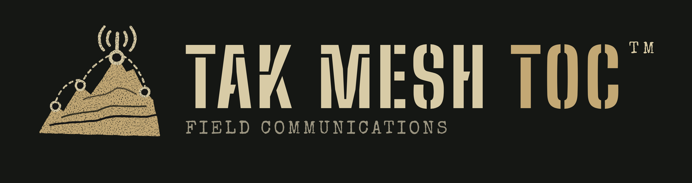
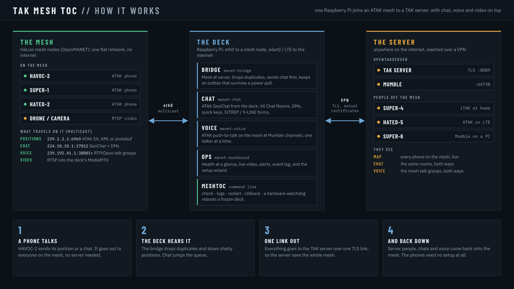
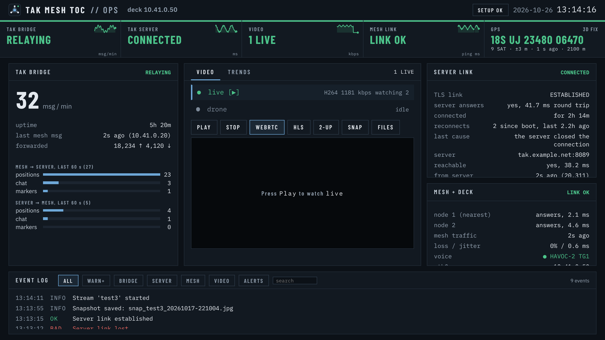
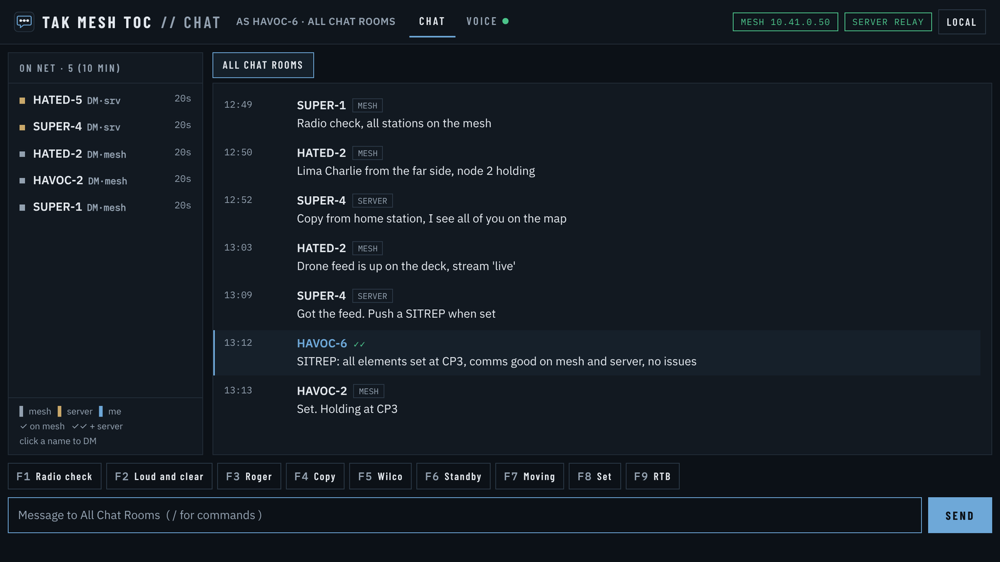
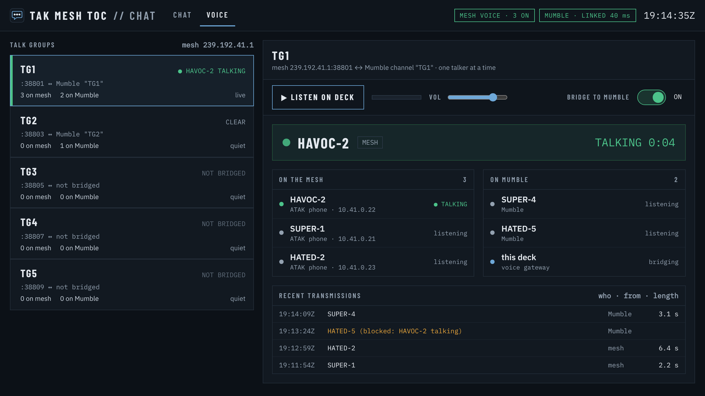

<p align="center">
  
</p>

<p align="center">
  <b>A portable TAK operations center for a mesh network.</b><br>
  One small Linux computer joins ATAK phones on a mesh radio network to your TAK server:
  positions, chat, markers, DMs and push-to-talk voice, both ways. The phones on the mesh need no internet,
  no server account and no certificate.
</p>

<p align="center">
  
  
  
  
</p>

---

## How it works

<p align="center"></p>

ATAK phones talk to each other on the mesh with ATAK's normal multicast. The **deck** (a Raspberry Pi wired to a mesh
node) carries that traffic to your TAK server over one TLS link and brings the server's traffic back onto the mesh.
People on the server see the mesh phones, and the mesh phones see them.

## What you get

| Part | What it does |
|---|---|
| **Bridge** | Mesh &#8644; server: positions, chat, markers and drawings, private DMs both ways, the deck's own GPS position |
| **Chat** | ATAK chat on the deck's own screen, mesh and server, including DMs, quick keys and report forms |
| **Ops** | A status dashboard: server link, mesh link, traffic, live video, GPS, voice and alerts, plus a setup wizard |
| **Voice** *(optional)* | Push-to-talk talk groups on the mesh &#8644; Mumble channels on your server |
| **`meshtoc`** | One command for check, logs, restart and rollback, with a watchdog for a frozen deck |

<p align="center">
  
  
</p>
<p align="center">
  
</p>

## Quick start

1. Download **`TAK_MESH_TOC.zip`** from [Releases](../../../releases) and copy it to the deck.
2. On the deck, as your normal user:
   ```
   unzip TAK_MESH_TOC.zip && cd TAK_MESH_TOC
   bash install.sh --icon
   ```
3. Open **http://127.0.0.1:8080** (or the TAK MESH TOC Ops icon). The setup wizard walks you through the rest.

**You need:** a Linux computer with systemd and Python 3.9 or newer (tested on Raspberry Pi 4 and 5 with Raspberry Pi
OS 12), a mesh that passes ATAK multicast (tested with OpenMANET HaLow), and a TAK server plus a data package for the
deck (tested with OpenTAKServer 1.7). Everything it needs is bundled, so the deck needs no internet.

The full guide (install, setup, every setting, DMs, voice, troubleshooting) is in the [README](../README.md).

## License

Copyright (C) 2026 Alejandro Rocha. TAK MESH TOC is free software under the
[GNU General Public License v3.0 or later](../LICENSE). Bundled libraries keep their own licenses: see
[THIRD_PARTY_NOTICES](../THIRD_PARTY_NOTICES.md).

TAK MESH TOC is an independent project. It is not affiliated with or endorsed by the TAK Product Center, OpenTAKServer
or OpenMANET.
